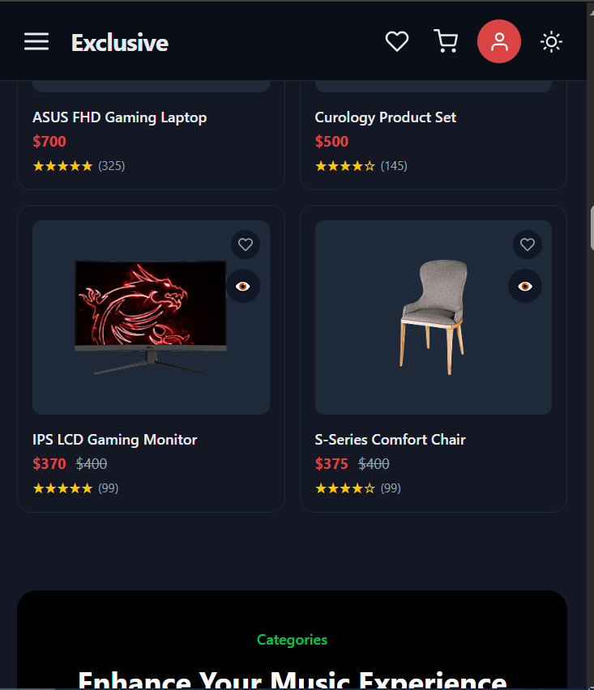
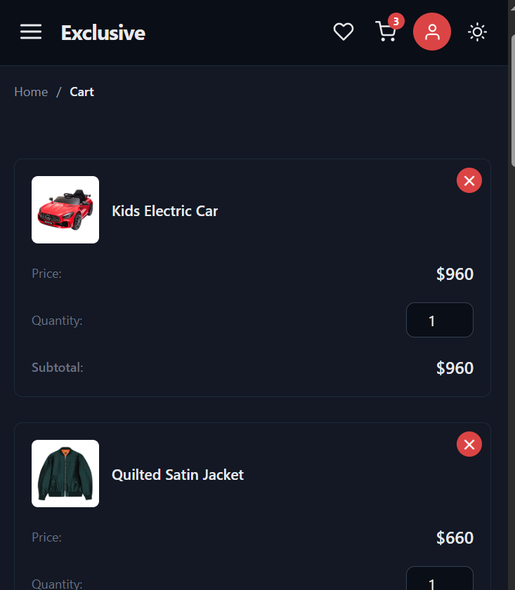
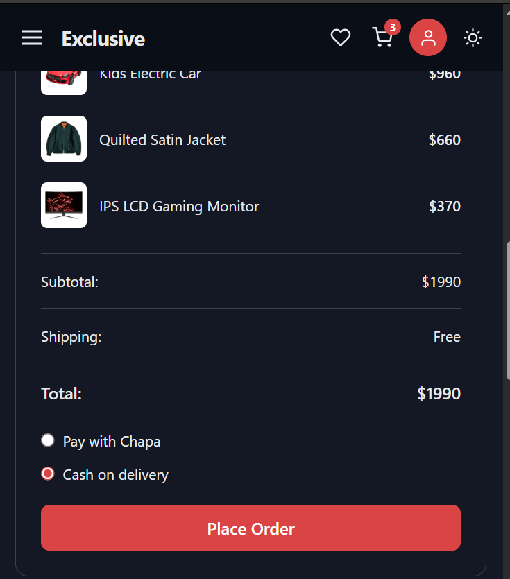

# Exclusive – E-commerce Frontend

A responsive online store built with React and Vite. Customers can browse products, manage a cart and wishlist, pay online or with cash on delivery, and track their orders. Admins manage products, orders and users.

**Live demo:** TODO_PASTE_VERCEL_URL
**Backend repository:** TODO_PASTE_BACKEND_REPO_URL

> The backend runs on a free hosting plan, so the first request after a quiet period can take up to a minute.

## Screenshots

| Home | Cart | Checkout |
| --- | --- | --- |
|  |  |  |

## Features

**Customers**
- Browse products by category, with search
- Cart with quantity updates and live totals
- Wishlist
- Sign up, log in, and Google sign-in
- Forgot and reset password by email
- Checkout with online payment (Chapa) or cash on delivery
- Order history and order status
- Contact form

**Admin**
- Create, edit and delete products, with image upload
- View all orders and update their status
- Manage user roles

## Tech stack

- React and Vite (JavaScript, ES modules)
- TODO: router (for example React Router)
- TODO: state management (for example Redux Toolkit, Context)
- TODO: styling (for example Tailwind CSS, CSS modules)
- TODO: HTTP client (Axios or fetch)
- TODO: notifications (for example react-hot-toast)
- Hosted on Vercel

## How it works

```text
Browser (React + Vite)  ──HTTPS──►  REST API (Node.js, Express, MongoDB)
                                      ├── JWT authentication
                                      ├── Cloudinary (product images)
                                      └── Chapa (payments, verified on the server)
```

The frontend only displays data and sends requests. All security decisions (prices, permissions, payment verification) are made by the backend.

## Getting started

**Requirements:** Node.js 20 or newer, and the backend running locally (see the backend repository).

```bash
git clone https://github.com/yaredkumera/e-commerce.git
cd e-commerce
npm install
```

Create a `.env` file in the project root:

```env
VITE_API_URL=http://localhost:5000/api
```

Start the app:

```bash
npm run dev
```

Open http://localhost:5173. In the backend `.env`, `FRONTEND_URL` must be `http://localhost:5173`, or the browser blocks the requests (CORS).

## Environment variables

| Variable | Description | Example |
| --- | --- | --- |
| `VITE_API_URL` | Base URL of the backend API | `http://localhost:5000/api` |
| TODO | Any other variable your code reads (for example a Google client ID) | |

Variables that start with `VITE_` are embedded in the browser bundle, so they are **public**. Never put secrets here. Payment secret keys live only in the backend.

## Scripts

| Command | What it does |
| --- | --- |
| `npm run dev` | Starts the development server |
| `npm run build` | Creates the production build in `dist/` |
| `npm run preview` | Serves the production build locally |
| `npm run lint` | Runs ESLint |

## Project structure

```text
src/
  TODO: paste the output of the tree command here
public/
vercel.json   # rewrites every route to index.html (single-page app)
```

## Deployment

The app is deployed on Vercel.

1. Import the repository in Vercel.
2. Add `VITE_API_URL` pointing to the deployed backend.
3. `vercel.json` rewrites all routes to `index.html`, so reloading a page like `/cart` works.
4. In the backend, set `FRONTEND_URL` to the exact Vercel address (no trailing slash).

## Payments

Online payments go through Chapa. The server verifies each payment with Chapa before an order is marked as paid. Use Chapa **test mode** keys during development.

## What I learned

- Building a full-stack app with separate frontend and backend deployments
- Protecting routes by role (customer and admin) and handling expired sessions
- Integrating a payment provider and why payments must be verified on the server
- Handling loading, empty and error states in the interface

## Author

Yared Kumera

[Yared Kumera](https://github.com/yaredkumera) — [GitHub](https://github.com/yaredkumera) | [UpWork](https://www.upwork.com/freelancers/~0191f91e607d8cfce6)
